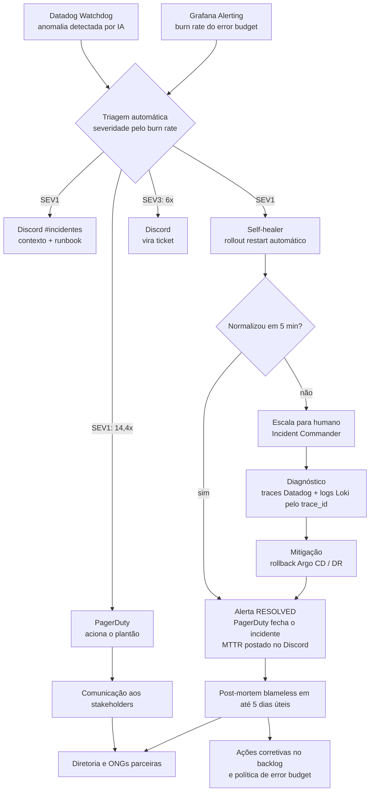

# ITSM e AIOps: ciclo de vida de um incidente na SolidaryTech

## Fluxo

## Etapas

| # | Etapa | Ferramenta | Responsável | Meta |
|---|---|---|---|---|
| 1 | **Detecção preditiva** (AIOps) | Datadog Watchdog: anomalias de latência, erros e tráfego sem threshold fixo | automático | antes de o doador perceber |
| 2 | **Detecção pelo SLO** | Grafana Alerting: burn rate multiwindow | automático | ≤ 2 min |
| 3 | **Triagem** | severidade derivada do burn rate (SEV1 = page, SEV3 = ticket) | automático | imediata |
| 4 | **Notificação** | PagerDuty (plantão) + Discord (canal do time) | automático | ≤ 1 min |
| 5 | **Remediação automática** | self-healer (runbook automation, allowlist e cooldown) | automático | ≤ 1 min |
| 6 | **Escalonamento** | se não normalizar: PagerDuty escala; Incident Commander assume | plantão | ≤ 15 min |
| 7 | **Comunicação** | template abaixo, por e-mail e status page | Incident Commander | 1ª mensagem ≤ 30 min (SLA) |
| 8 | **Resolução** | alerta RESOLVED fecha o incidente no PagerDuty | automático | MTTR registrado |
| 9 | **Post-mortem** | documento blameless (template abaixo) | time + IC | ≤ 5 dias úteis |
| 10 | **Melhoria contínua** | ações no backlog; consumo do error budget decide prioridades | Product Owner + SRE | revisão mensal |

## Severidades

| Sev | Critério | Exemplo | Quem é acionado |
|---|---|---|---|
| SEV1 | Doações falhando ou lentas (burn rate ≥ 14,4x) | 30% das doações com HTTP 500 | PagerDuty + Discord + self-healer |
| SEV2 | Serviço secundário fora (ONGs/voluntários) | cadastro de voluntários com erro | Discord + plantão em horário comercial |
| SEV3 | Degradação lenta (burn rate ≥ 6x em 6h) ou alerta de custo | quota do namespace em 85% | Discord (ticket) |

## Comunicação aos stakeholders

| Público | Canal | Quando | Conteúdo |
|---|---|---|---|
| Time técnico | Discord #incidentes | automático, em tempo real | alerta, runbook, ação automática, MTTR |
| Diretoria | e-mail | SEV1: início, a cada 1h e no fim | impacto em doações, previsão, próximos passos |
| ONGs parceiras | e-mail + status page | SEV1 > 15 min | o que aconteceu, impacto, quando volta |
| Doadores | aviso no site | SEV1 > 30 min | "doações temporariamente indisponíveis; nenhum valor foi cobrado em duplicidade" |

**Modelo de mensagem (SEV1):**
> **[SolidaryTech] Instabilidade nas doações - HH:MM**
> Identificamos às HH:MM falhas em parte das doações. A equipe já atua na correção; nenhuma doação aprovada foi perdida. Próxima atualização às HH:MM.

## Modelo de post-mortem (blameless)

1. **Resumo:** o que aconteceu, em 3 linhas.
2. **Impacto:** doações afetadas, duração, error budget consumido (dashboard SRE).
3. **Linha do tempo** (UTC): detecção → notificação → ação automática → resolução (logs do self-healer e PagerDuty).
4. **Causa raiz:** técnica e de processo, sem culpados.
5. **O que funcionou / o que não funcionou.**
6. **Ações corretivas:** dono e prazo, no backlog.
7. **Métricas:** MTTD, MTTR, % do budget consumido.

## AIOps no Datadog

- **Watchdog:** ligado automaticamente com o APM. Aprende o comportamento normal de cada serviço (latência, taxa de erro e tráfego por endpoint) e abre um **Watchdog Alert** quando algo foge do padrão, sem threshold fixo.
- **Watchdog Insights:** no trace explorer, aponta quais tags (pod, versão, endpoint) concentram os erros, acelerando o diagnóstico.
- **Monitor de Watchdog → PagerDuty:** `scripts/datadog-aiops.ps1` (repo de infra) cria via API um monitor dos alertas do Watchdog para o `env:production` e um SLO de disponibilidade no próprio Datadog.
